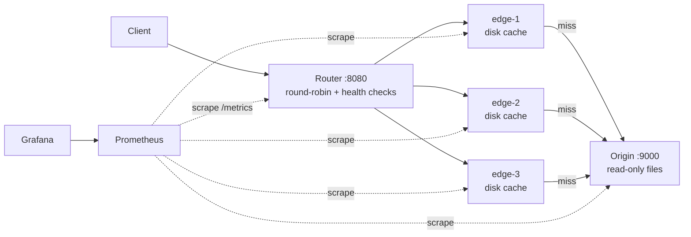

# Mini-CDN

A small CDN simulation in Go: one origin, three edge cache nodes and a round-robin router, with TTL + LRU disk caching and Prometheus/Grafana monitoring. Everything runs with Docker Compose.

## Overview

A client always talks to the **router**. The router picks the next healthy **edge** (round-robin) and reverse-proxies the request. The edge serves the file from its **disk cache** if the entry is fresh. Otherwise it fetches it from the **origin**, streams it to the client and writes it to disk at the same time, then evicts least-recently-used files if the cache is over its byte budget.

## Architecture



| Component | Code | Responsibility |
|---|---|---|
| Router | `router/` | Round-robin over healthy edges, `/healthz` probe every 2 s, marks an edge unhealthy on proxy error, fans `/purge` and `/cache/*` out to every edge |
| Edge | `edge/` | `DiskCache`: TTL check, origin fetch, streaming tee to client + temp file, atomic rename, LRU eviction, stale-on-error serving |
| Origin | `origin/` | Serves source files from a read-only volume |
| Shared | `internal/metrics`, `internal/safepath` | Minimal Prometheus text-format registry; path cleaning + `SafeJoin` to block `..` traversal |

## Design decisions

- **Disk cache, in-memory index.** Files live on a per-edge volume. The index (`size`, `cachedAt`, `lastAccess`) is rebuilt lazily from disk on first access, so an edge restart keeps its cache.
- **Stream while caching.** On a miss the origin body is copied to the client and a temp file at once (`io.MultiWriter`), then the temp file is renamed into place, so a half-downloaded file never becomes a cache entry.
- **Serve stale on origin failure.** If the origin fetch fails and an expired copy exists, the edge serves it with `X-Cache: STALE` instead of returning 502.
- **LRU by last access, bounded by bytes.** `CACHE_MAX_BYTES` (default 500 MB) caps each edge. The file that was just written is protected from eviction.
- **Observable by default.** Request, hit, miss, stale, origin-fetch and eviction counters, cache bytes, edge health and latency are exposed on `/metrics`. A Grafana dashboard is provisioned automatically.

## Quickstart

```bash
docker compose up --build

curl -i http://localhost:8080/images/test.png   # X-Cache: MISS, then HIT per edge
curl -X POST -i http://localhost:8080/purge      # clear every edge
go test ./...
```

Grafana: http://localhost:3000 (admin / admin, local only).

Response headers: `X-Cache` (HIT / MISS / STALE), `X-Edge-Node`, `X-Router-Strategy`.

## Configuration

| Variable | Default | Where |
|---|---|---|
| `CACHE_TTL` | `5m` | edge |
| `CACHE_MAX_BYTES` | `524288000` | edge |
| `ORIGIN_BASE_URL` | `http://origin:9000` | edge |
| `EDGES` | comma-separated edge URLs | router |

## Results

Benchmark coming soon: hit ratio, p50/p95 latency for HIT vs MISS, and origin offload under a repeatable load test.

## Next steps

- Coalesce concurrent misses for the same key (single-flight) so a cold file hits the origin once.
- Replace the O(n) LRU victim scan with a heap or linked list.
- Consistent hashing instead of round-robin, so each file is cached on one edge rather than three.
