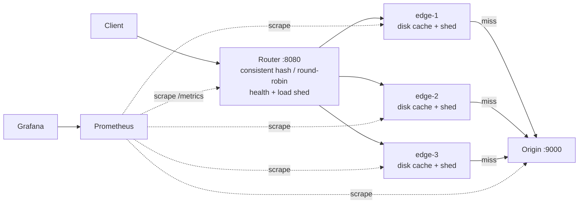

# Mini-CDN

A small CDN simulation in Go: one origin, three edge cache nodes and a router with **consistent hashing** (or round-robin), **partial-failure** ring sync, **load shedding**, TTL + LRU disk caching, and Prometheus/Grafana monitoring. Everything runs with Docker Compose.

## Overview

A client always talks to the **router**. The router selects a healthy **edge** (consistent hash by path, or round-robin) and reverse-proxies the request. If the router or edge is over its in-flight budget it returns **503** with `X-Load-Shed: 1` instead of queueing forever. The edge serves from its **disk cache** when fresh; otherwise it fetches from the **origin**, streams to the client, and writes to disk.

## Architecture



| Component | Code | Responsibility |
|---|---|---|
| Router | `router/` | Strategy `consistent` \| `roundrobin`, virtual-node hash ring synced to healthy edges, `/healthz` every 2 s, load shed via `MAX_INFLIGHT`, fans `/purge` and `/cache/*` to every edge |
| Hash ring | `internal/hashring` | FNV-1a consistent hashing with virtual nodes; `SetNodes` rebuilds when membership changes |
| Edge | `edge/` | `DiskCache` + optional in-flight load shed |
| Origin | `origin/` | Read-only source files |
| Shared | `internal/metrics`, `internal/safepath` | Prometheus text registry; path cleaning |

## What this lab teaches

1. **Consistent hashing** — same URL path → same edge (cache affinity). Virtual nodes spread keys evenly. Flip to round-robin with `ROUTER_STRATEGY=roundrobin`.
2. **Partial failure** — health checks and proxy errors mark an edge unhealthy; the ring drops it so traffic remaps onto survivors without a hard outage.
3. **Load shedding** — when in-flight requests exceed `MAX_INFLIGHT`, return 503 + `Retry-After` + `X-Load-Shed: 1` and increment `cdn_load_shed_total` instead of collapsing latency for everyone.

## Design decisions

- **Disk cache, in-memory index.** Per-edge volume; index rebuilt lazily from disk.
- **Stream while caching.** Origin body teed to client + temp file, then atomic rename.
- **Serve stale on origin failure.** `X-Cache: STALE` when an expired copy exists.
- **Ring follows health.** `MarkHealth` rebuilds membership; gauges `cdn_hash_ring_member` / `cdn_hash_ring_members` expose it.
- **Observable by default.** Hit/miss/stale, latency sum/count, shed counters, edge health, ring membership — Grafana dashboard provisioned automatically.

## Quickstart

```bash
docker compose up --build

curl -i http://localhost:8080/images/test.png
# X-Router-Strategy: consistent
# X-Edge-Selected: edge-N
# X-Cache: MISS then HIT on the same edge

curl -X POST -i http://localhost:8080/purge
go test ./...
```

Grafana: http://localhost:3000 (admin / admin, local only). Prometheus: http://localhost:9090.

Response headers: `X-Cache` (HIT / MISS / STALE), `X-Edge-Node`, `X-Edge-Selected`, `X-Router-Strategy`, and on shed `X-Load-Shed` + `Retry-After`.

## Demo: partial failure

```bash
# steady traffic
while true; do curl -s -o /dev/null -w "%{http_code} %{header_json}\n" -D - http://localhost:8080/images/test.png -o /dev/null | head -5; sleep 0.2; done

# kill one edge — requests should keep succeeding on the other two
docker compose stop edge-2

# watch Grafana "Edge Health" + "Hash Ring Membership"
# restore
docker compose start edge-2
```

## Demo: load shedding

```bash
# tighten router budget (compose default is 64; override for the demo)
docker compose stop router
MAX_INFLIGHT=2 docker compose run --rm --service-ports \
  -e MAX_INFLIGHT=2 -e ROUTER_STRATEGY=consistent \
  -e EDGES=http://edge-1:9100,http://edge-2:9100,http://edge-3:9100 \
  router
# or edit docker-compose.yml router MAX_INFLIGHT to "2" and recreate

# burst — expect some 503 with X-Load-Shed: 1
seq 1 40 | xargs -P 20 -I{} curl -s -o /dev/null -w "%{http_code}\n" http://localhost:8080/images/test.png | sort | uniq -c
```

## Configuration

| Variable | Default | Where |
|---|---|---|
| `ROUTER_STRATEGY` | `consistent` | router (`consistent` \| `roundrobin`) |
| `HASH_VNODES` | `100` | router virtual nodes per edge |
| `MAX_INFLIGHT` | `0` (unlimited) / compose: router `64`, edge `32` | router & edge |
| `CACHE_TTL` | `5m` | edge |
| `CACHE_MAX_BYTES` | `524288000` | edge |
| `ORIGIN_BASE_URL` | `http://origin:9000` | edge |
| `EDGES` | comma-separated edge URLs | router |

## Metrics (new / notable)

| Metric | Meaning |
|---|---|
| `cdn_hash_ring_members{strategy=}` | healthy edges currently on the ring |
| `cdn_hash_ring_member{edge=}` | 1 if that edge is on the ring |
| `cdn_load_shed_total{component=,edge=}` | shed counter |
| `cdn_edge_healthy{edge=}` | health probe result |
| `cdn_cache_hits_total` / `misses` / `stale_serves` | cache outcome |
| `cdn_*_response_duration_seconds_{sum,count}` | latency for avg = sum/count |

## Results

With consistent hashing, a given path sticks to one edge so cold misses hit origin once per key (not once per edge). Killing an edge remaps its keys; survivors absorb the load. Under overload, shed rate rises while healthy requests keep bounded latency — visible on the Grafana "Load Shed Rate" and "Latency" panels.

## Next steps

- Coalesce concurrent misses for the same key (single-flight).
- Replace the O(n) LRU victim scan with a heap or linked list.
- Weighted consistent hashing / bounded loads when edges differ in capacity.
