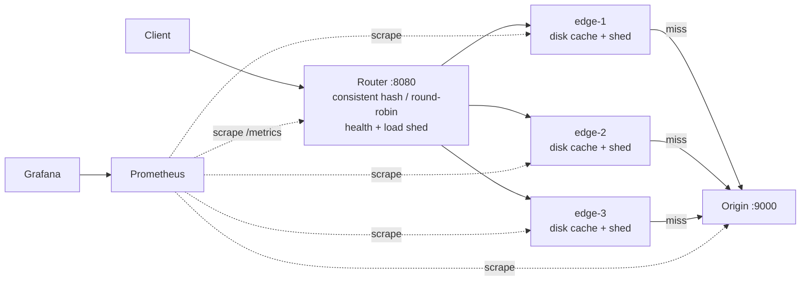

# Mini-CDN

CDN simulation in Go: one origin, three edge caches, a router with consistent hashing (or round-robin), partial-failure ring sync, load shedding, TTL + LRU disk cache, Prometheus/Grafana.

## Overview

Clients talk to the **router**. The router picks a healthy **edge** (consistent hash by path, or round-robin) and reverse-proxies. Over the in-flight budget → **503** + `X-Load-Shed: 1`. Edges serve from disk cache when fresh; otherwise fetch from **origin**, stream to the client, and write to disk.

## Architecture



| Component | Code | Responsibility |
|---|---|---|
| Router | `router/` | Strategy `consistent` | `roundrobin`, virtual-node hash ring, health every 2 s, load shed via `MAX_INFLIGHT`, fans `/purge` and `/cache/*` |
| Hash ring | `internal/hashring` | FNV-1a consistent hashing with virtual nodes; `SetNodes` on membership change |
| Edge | `edge/` | Disk cache + optional in-flight load shed |
| Origin | `origin/` | Read-only source files |
| Shared | `internal/metrics`, `internal/safepath` | Prometheus registry; path cleaning |

## Quickstart

```bash
docker compose up --build

curl -i http://localhost:8080/images/test.png
# X-Router-Strategy: consistent
# X-Edge-Selected: edge-N
# X-Cache: MISS then HIT on the same edge

curl -X POST -i http://localhost:8080/purge
go test ./...
```

Grafana: http://localhost:3000 (admin / admin). Prometheus: http://localhost:9090.

Headers: `X-Cache` (HIT / MISS / STALE), `X-Edge-Node`, `X-Edge-Selected`, `X-Router-Strategy`; on shed `X-Load-Shed` + `Retry-After`.

## Demo: partial failure

```bash
while true; do curl -s -o /dev/null -w "%{http_code}\n" http://localhost:8080/images/test.png; sleep 0.2; done

docker compose stop edge-2   # traffic remaps to remaining edges
docker compose start edge-2
```

## Demo: load shedding

```bash
# set router MAX_INFLIGHT=2 in docker-compose.yml (or recreate with -e), then:
seq 1 40 | xargs -P 20 -I{} curl -s -o /dev/null -w "%{http_code}\n" http://localhost:8080/images/test.png | sort | uniq -c
```

## Configuration

| Variable | Default | Where |
|---|---|---|
| `ROUTER_STRATEGY` | `consistent` | router (`consistent` | `roundrobin`) |
| `HASH_VNODES` | `100` | router |
| `MAX_INFLIGHT` | `0` (unlimited); compose: router `64`, edge `32` | router & edge |
| `CACHE_TTL` | `5m` | edge |
| `CACHE_MAX_BYTES` | `524288000` | edge |
| `ORIGIN_BASE_URL` | `http://origin:9000` | edge |
| `EDGES` | comma-separated edge URLs | router |

## Metrics

| Metric | Meaning |
|---|---|
| `cdn_hash_ring_members{strategy=}` | healthy edges on the ring |
| `cdn_hash_ring_member{edge=}` | 1 if edge is on the ring |
| `cdn_load_shed_total{component=,edge=}` | shed counter |
| `cdn_edge_healthy{edge=}` | health probe |
| `cdn_cache_hits_total` / `misses` / `stale_serves` | cache outcome |
| `cdn_*_response_duration_seconds_{sum,count}` | latency |

## Design notes

- Disk cache with in-memory index (rebuilt lazily). Concurrent misses of one object count its bytes once.
- Stream while caching: origin body teed to client + temp file, then atomic rename.
- Serve stale on origin failure (`X-Cache: STALE`) only if the client response has not started. A mid-body origin error is not followed by a second body.
- Ring membership follows health probes. Distinct `host:port` values stay distinct when several edges share a hostname.
- GET and HEAD try one other healthy edge when the selected edge fails before writing a response (`X-Edge-Failover`). POST is not retried.
